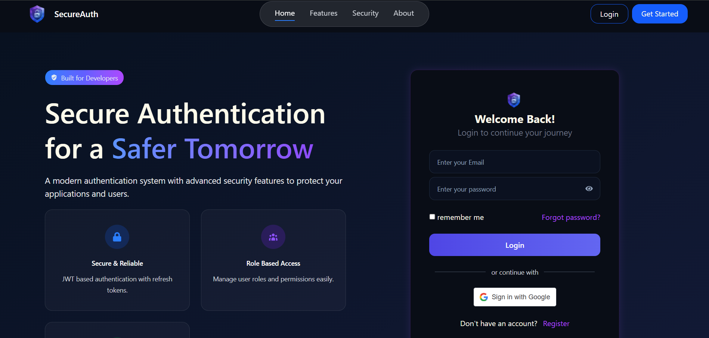
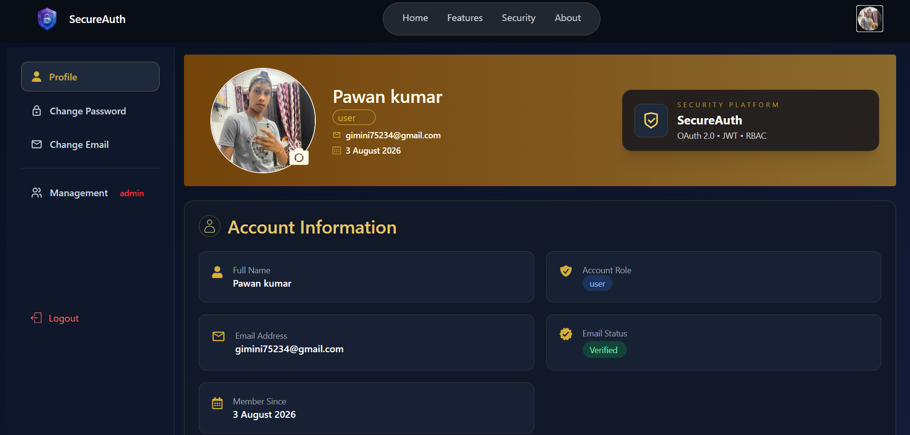
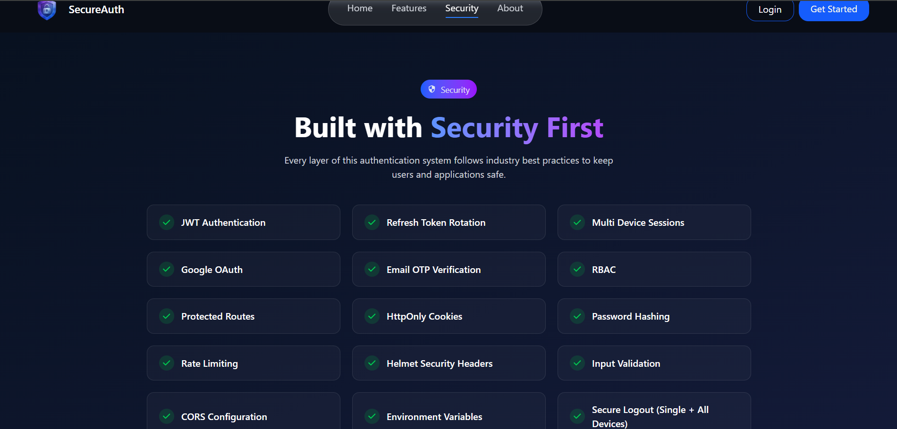
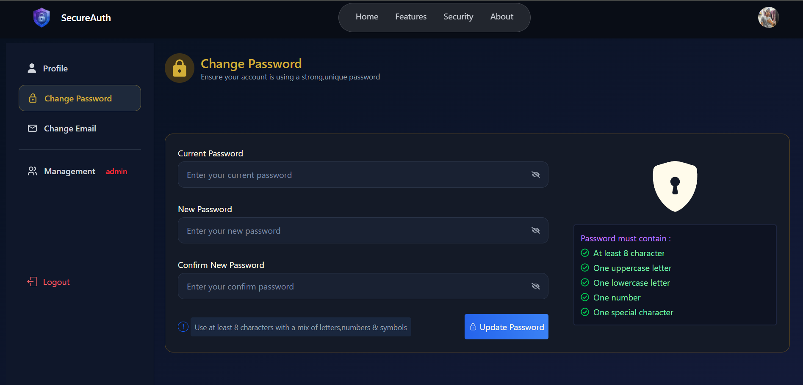

# 🔐 SecureAuth

A production-ready authentication and authorization system built with the MERN Stack. It includes JWT Authentication, Google OAuth, Email OTP Verification, Role-Based Access Control (RBAC), Profile Management, and Admin Dashboard.

---

# 📸 Screenshots

## 🏠 Home Page



---

## 👤 Profile Dashboard



---

## 🔒 Security Features



---

## 🔑 Change Password



---

# ✨ Features

### 🔑 Authentication
- Email & Password Registration
- Secure Login
- Google OAuth Login
- Email OTP Verification
- JWT Authentication
- Refresh Token Authentication
- HTTP-Only Cookie Authentication
- Multi Device Login Support

### 👤 User Features
- User Profile
- Upload Profile Picture
- Change Password
- Change Email with OTP Verification
- View Account Information

### 🛡️ Admin Features
- User Management Dashboard
- View All Users
- Change User Roles
- Block / Unblock Users
- Role-Based Access Control (RBAC)

### 🔒 Security
- Password Hashing (bcrypt)
- JWT Access & Refresh Tokens
- Protected Routes
- Secure Cookies
- OTP Expiration
- Input Validation
- Authentication Middleware

---

# 🛠 Tech Stack

### Frontend
- React (Vite)
- Tailwind CSS
- React Router DOM
- Axios
- React Hot Toast
- React Icons
- Google OAuth

### Backend
- Node.js
- Express.js
- MongoDB
- Mongoose
- JWT
- bcrypt
- Resend email API
- Validator

---

## Email OTP configuration

The backend sends OTP email through the Resend HTTPS API. This works on Render's free web services, which block outbound SMTP connections on ports 25, 465, and 587.

1. Create a Resend API key and verify the sender domain/address with Resend.
2. Set `RESEND_API_KEY` and `EMAIL_FROM` in the backend service's Render environment settings. `EMAIL_FROM` must use a sender Resend has authorized.
3. Redeploy the backend after saving the environment variables.

For local development, copy `backend/.env.example` to `backend/.env` and set those variables. Do not commit the real API key.

If mail delivery fails, the backend returns the email provider's error and leaves unverified accounts eligible to retry registration or request another OTP.

---

# 📂 Folder Structure

```text
Authentication-System
│
├── backend
│   ├── config
│   ├── controllers
│   ├── middleware
│   ├── models
│   ├── routes
│   ├── utils
│   └── server.js
│
├── frontend
│   ├── public
│   ├── src
│   └── vite.config.js
│
├── screenShots
│   ├── homePage.png
│   ├── ProfilePage.png
│   ├── securityPage.png
│   └── changePasswordPage.png
│
├── .gitignore
└── README.md
```

# 👨‍💻 Author

**Pawan Tanwer**

GitHub: https://github.com/pawan-tanwer

LinkedIn: *((https://www.linkedin.com/in/pawan-tanwar-604372407/))*

---

## ⭐ If you found this project useful, consider giving it a star.
